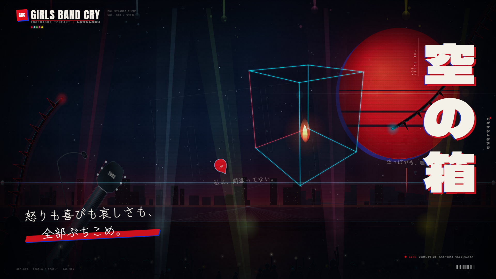
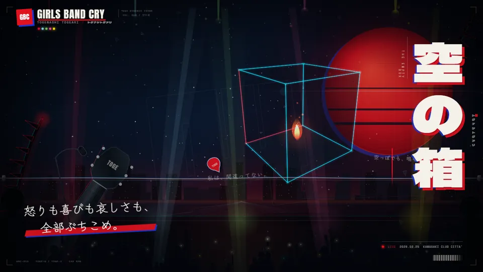
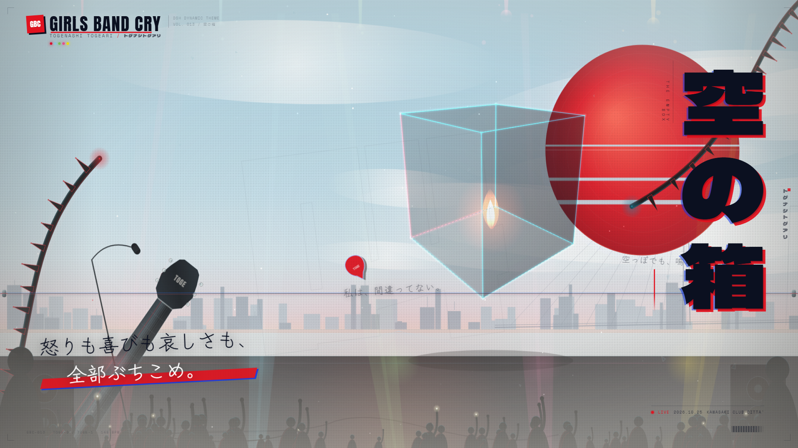
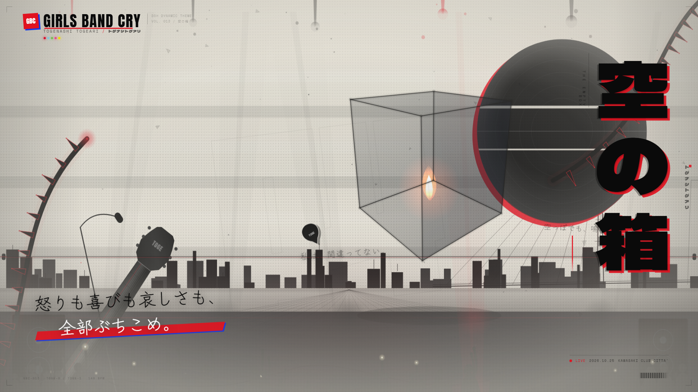
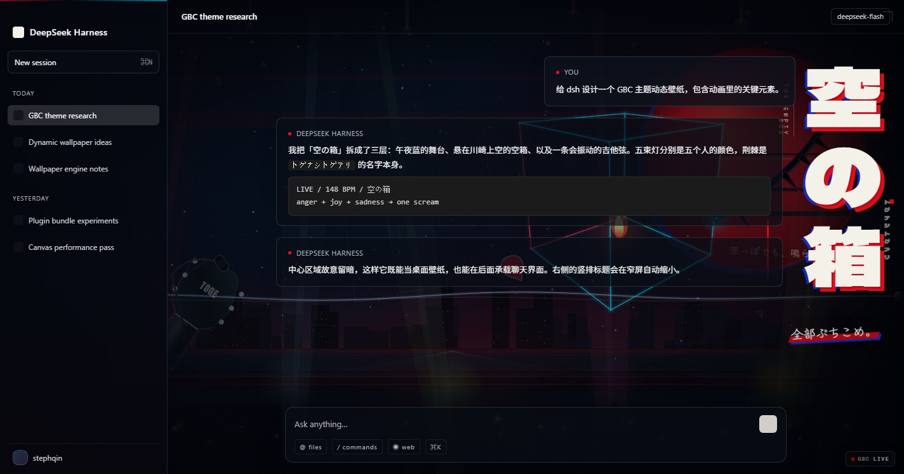
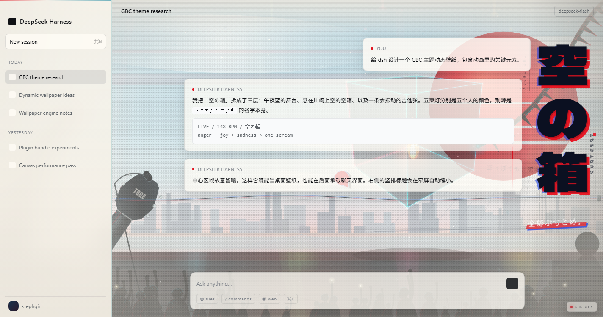
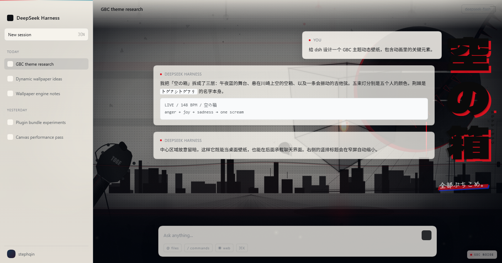

# 空の箱 / THE EMPTY BOX

**GIRLS BAND CRY × DeepSeek Harness — 动态壁纸主题**





> 「怒りも喜びも哀しさも、全部ぶちこめ。」
>
> 把愤怒、喜悦、悲伤，全部砸进去。

这是一个为 **DSH（DeepSeek Harness）** 设计的 GBC（《GIRLS BAND CRY / ガールズバンドクライ》）同人动态壁纸。它既是一个可以直接打开的 16:9 网页壁纸，也可以作为 DSH Web 界面的玻璃拟态主题运行。

---

## 1. 设计概念

我没有直接把动画截图贴上去，而是把 GBC 的视觉语言拆成了几个可以动的部件：

### 空の箱 / The Empty Box

画面中间悬浮着一个**没有盖子的线框箱子**，箱底有一小簇火焰。

「空の箱」是 GBC 里最重要的一首歌，也是仁菜与桃香之间的连接点。箱子是空的，但并不安静——里面还有火，还能响。壁纸里它慢慢旋转、漂浮，每四小节从开口处打出一束光。

> 空っぽでも、鳴らせ。  
> 就算是空的，也要让它响。

### 红色太阳 / 蓝色错版 / 网点

主色来自 GBC 的印刷感海报：**血红、电蓝、纸白、墨黑**。巨大的红色圆盘像舞台背光，也像一面被撕下来的海报；蓝色圆盘故意错开几个像素，做出旧印刷的套色不准。太阳上叠了网点、横向撕裂和扫描线，标题则用红/蓝双重错版。

### 五束光 = 五个人

舞台底部打了五束光，颜色分别对应五位成员：

| 成员 | 代表色 |
|---|---|
| 井芹仁菜 | `#D90E2C` |
| 河原木桃香 | `#85C9DC` |
| 安和昴 | `#76BD53` |
| 海老塚智 | `#E34D8D` |
| RUPA | `#EEDA01` |

顶部也有一排五色油漆滴落，像 Live House 墙上没干的海报。

### 荆棘

乐队名 **トゲナシトゲアリ**（Togenashi Togeari）本身就在玩「有刺 / 无刺」的文字游戏。画面左右边缘爬着黑底红/青描边的荆棘藤，刺是三角的，尖端会随着节拍发亮。

### 吉他、麦克风、人群

- 左下角是一把从画面外伸进来的**电吉他琴颈与琴头**，琴头写着 `TOGE`，六根弦沿着琴颈消失。
- 一条横贯画面的**吉他弦**会自己振动；点击画面或按空格会用力拨一下，红色拨片 `TOGE` 悬在弦边。
- 底部有麦克风架、返听音箱、舞台灯和人群的手机灯。人群大部分时间只是暗色剪影，节拍到来时才轻轻起伏。

### 字体

- `空の箱`：**Dela Gothic One**，竖排，像 Live 海报上的粗黑体。
- 手写句：**Zen Kurenaido**，模仿马克笔写在撕下来的纸上的感觉。
- `GIRLS BAND CRY`：**Anton**，压缩无衬线，加了轻微粗糙滤镜。
- 小字、编号、时间码：**Space Mono**。

所有字体都按用到的字符做了子集化，以 base64 内嵌，不依赖系统日文字体，也不发网络请求。

---

## 2. 三种模式

| LIVE | SKY | NOISE |
|---|---|---|
|  |  |  |
| 默认。午夜蓝舞台、红日、霓虹。 | 白天模式。青空、白云、纸感城市。 | 复印机/噪点海报。黑白红，粗糙网点。 |

- 按 `M` 或点底部 HUD 切换。
- `?mode=sky` / `?mode=noise` 可以直接以指定模式打开。
- 独立壁纸会根据本地时间在 LIVE / SKY 之间选择；DSH 插件根据界面深浅色选择，并在切换模式时同步切换 DSH 外观（见第 4 节）。

---

## 3. 交互

| 操作 | 效果 |
|---|---|
| 鼠标移动 | 轻微视差；标题、箱子、星星会跟着动 |
| 点击画面 / 空格 | 拨弦 + 碎片爆开 + 短暂 glitch |
| `M` | 切换 LIVE / SKY / NOISE |
| `P` | 暂停 / 继续 |
| `H` | 隐藏 / 显示文字与 HUD（得到一张干净壁纸） |
| `Alt + G` | DSH 内切换模式 |
| HUD 按钮 | LIVE / SKY / NOISE / PAUSE / HIDE |

HUD 在 5 秒无操作后自动淡出；按 `H` 或在 DSH 里把鼠标移到右下角 `GBC` 小标签上可再次唤出。

---

## 4. 在 DSH 里使用

### 插件会做什么

- 把 DSH 的 frame / center column 变透明，让壁纸透出来；
- 左侧栏与右侧栏变成烟熏玻璃（`backdrop-filter`）；
- 覆盖 `--dsw-alias-bg-layer-*` 等 token，让卡片、输入框变成半透明玻璃；
- **切换 LIVE / SKY / NOISE 时同步 DSH 的 dark / light 外观**：`LIVE → dark`，`SKY / NOISE → light`。这样聊天文字始终与玻璃面板保持对比，不会出现「黑字落在深色 LIVE 壁纸上」；
- **顶部 82px 的阅读 scrim 跟随当前 shell 深浅色**（`data-shell`），NOISE / SKY 的浅色纸面或 LIVE 的深色背景下，项目名 / 会话标题都保持可读；
- **DSH 内隐藏左上角的 `GIRLS BAND CRY` masthead**，避免遮挡项目名 / 会话标题；独立壁纸仍然保留它。主题识别由右侧竖排 `空の箱` 和右下角 `GBC` chip 承担；
- **DSH 内把手写标语上移到输入框上方**，并隐藏 `私は、間違ってない。` 小字，避免被 composer 挡住；独立壁纸的排版不受影响；
- 在右下角放一个低透明度的 `GBC` 小标签，点击循环 LIVE / SKY / NOISE；
- 不改动任何 DSH 源文件；卸载插件后 shell 恢复原样（外观偏好会保留最后一次同步结果，可在 DSH 设置里改回）。

> 外观同步通过 DSH 的 `ctx.get('theme').setTheme()` 写入 `ui-theme` 偏好，因此会持久化；插件首次加载时也会按当前壁纸模式同步一次。这是为了确保聊天文字和玻璃面板始终有足够对比度。如果 theme 服务不可用或写入失败，插件会回退到 `body[data-ds-dark-theme]`，并按实际 shell 状态调整顶部阅读 scrim。







### 安装方式 A：DSH 插件管理器

插件包：`dsh-gbc-theme/`，打包文件：`dist/dsh-gbc-theme-1.0.3.tgz`。

1. 打开 DSH 的 **设置 → 插件**（或插件市场 / Discover）。
2. 选择**本地安装 / 从文件安装**，指向：
   - 目录：`<项目路径>\dsh-gbc-theme`
   - 或 tarball：`<项目路径>\dist\dsh-gbc-theme-1.0.3.tgz`
3. 安装后启用 `dsh-gbc-theme`。如果提示需要重启，完全退出 DSH（包括托盘）再启动。

### 安装方式 B：本地安装脚本（Windows）

```powershell
# 建议先完全退出 DSH（包括托盘），再运行
powershell -NoProfile -ExecutionPolicy Bypass -File .\install-dsh-theme.ps1

# 卸载
powershell -NoProfile -ExecutionPolicy Bypass -File .\install-dsh-theme.ps1 -Uninstall
```

脚本会：

1. 在 `~/.dsh/profiles/desktop/.gbc-theme-backup-<时间>/` 备份 `package.json`、`pnpm-lock.yaml` 等；
2. 自动选取 `dist/dsh-gbc-theme-*.tgz` 中最新的一个，复制到 profile 的 `vendor/`，用 `pnpm add` 安装（离线、跳过脚本）；
3. 把 `dsh-gbc-theme` 追加到 `dsh.profile.bundles`；
4. 校验 JSON 和安装产物；失败时自动恢复备份。

脚本不会改 `cordis.patch.yml`：DSH 会读取插件包自带的 `cordis.patch.yml`（`dsh.bundle.patch`），把 host 条目插进配置树。

> 桌面 profile 由 Electron 应用独占管理，直接手改 `~/.dsh/profiles/desktop` 有风险。优先使用插件管理器；用脚本时先退出 DSH，并保留脚本生成的备份目录。

### 卸载

优先用 DSH 插件管理器停用/卸载；用脚本安装的，可以直接运行上面的 `-Uninstall`。壁纸本身不写任何持久数据，只在 `localStorage` 里记一个模式偏好（`gbc-wallpaper-mode`）。

---

## 5. 当桌面壁纸用

### 浏览器

直接打开 `dist/index.html`，按 `F11` 全屏。

### Lively Wallpaper

`Add Wallpaper` → 选择 `dist/index.html` → 设为 Web Wallpaper。

### Wallpaper Engine

新建 Web Wallpaper 项目，把 `dist/index.html` 作为入口，预览图用 `dist/preview-live.png`。也可以直接把 `dist/index.html` 拖进 Lively 使用。

### OBS / 直播

把 `dist/index.html` 作为浏览器源，1920×1080，勾选「关闭源时关闭页面」。

---

## 6. 文件结构

```
gbc-wallpaper/
├─ dist/
│  ├─ index.html                 # 单文件动态壁纸（字体、CSS、JS 全部内嵌）
│  ├─ preview-live.png           # 1920×1080 LIVE 预览
│  ├─ preview-sky.png            # 1920×1080 SKY 预览
│  ├─ preview-noise.png          # 1920×1080 NOISE 预览
│  ├─ preview-dsh.png            # DSH 集成预览（LIVE / dark）
│  ├─ preview-dsh-sky.png        # DSH 集成预览（SKY / light）
│  ├─ preview-dsh-noise.png      # DSH 集成预览（NOISE / light）
│  ├─ preview.webp               # 动态预览（48 帧，960×540）
│  └─ dsh-gbc-theme-1.0.3.tgz    # 可安装的 DSH 插件包
├─ dsh-gbc-theme/                # 插件源码/构建产物
│  ├─ package.json
│  ├─ cordis.patch.yml
│  └─ lib/{index.js,client.js}
├─ src/
│  ├─ wallpaper.js               # Canvas 场景引擎
│  ├─ wallpaper.css              # 排版、纹理、HUD、DSH 版式
│  ├─ dsh-theme.css              # DSH 宿主玻璃化覆盖
│  ├─ markup.html                # 壁纸 DOM
│  ├─ fonts.css / fonts/         # 子集字体
│  └─ index.template.html
├─ tools/
│  ├─ fetch-fonts.mjs            # 从 Google Fonts 拉取 text= 子集
│  └─ build.mjs                  # 生成单文件壁纸 + DSH client bundle
├─ install-dsh-theme.ps1         # 备份/安装/卸载桌面 profile（-Uninstall）
└─ README.md
```

重新构建：

```bash
node tools/fetch-fonts.mjs   # 只有字体缺失时需要
node tools/build.mjs
```

---

## 7. 技术细节

- **纯 Canvas 2D + DOM 排版**，无第三方运行时依赖；单文件约 131 KB。
- 场景分层：静态背景（渐变、星空、城市、川崎大桥、舞台）预渲染到离屏 canvas；动态层只画太阳、光束、箱子、荆棘、弦、粒子、人群。
- **DPR 上限 1.5**，并按屏幕像素总量封顶；页面隐藏时暂停；`prefers-reduced-motion` 下只画一帧静态构图。
- 字体为 **SIL OFL** 许可的 Google Fonts 子集（Anton、Dela Gothic One、Zen Kurenaido、Space Mono），已内嵌，离线可用。
- 场景中的所有图形均为代码绘制，**没有使用动画截图或官方立绘**。
- 手机/竖屏有单独的排版规则；标题、手写句、HUD 会自动让位。

### 已验证

- Chromium 1280×720 / 1920×1080 / 2560×1440 / 900×1440 下无 JS 异常；点击拨弦、三模式切换、HUD 显隐均正常。
- `prefers-reduced-motion: reduce` 时 `raf` 停止，只保留一帧静态构图。
- 在复刻 DSH shell（`mP3x-q_*` 类名、`--dsw-*` token、`body[data-ds-dark-theme]`、`ctx.get('theme')`）的本地 mock 里验证了：插件挂载、玻璃侧栏、左上角 masthead 隐藏、顶部阅读 scrim、chip 循环模式、模式切换时 `dark/light` 同步、NOISE 下项目名对比度、标语避开输入框，以及卸载清理。
- 1280×720 无 GPU 的 headless Chromium 约 44 fps；真实 Electron/GPU 环境会更高。4K 时通过像素总量上限自动降低 backing-store DPR。

---

## 8. 同人声明 / Credits

这是非官方同人作品，仅用于个人桌面与 DSH 主题实验，不用于商业用途。

- 《GIRLS BAND CRY / ガールズバンドクライ》© 東映アニメーション、agehasprings、Universal Music 等权利人。
- 歌词/标语「怒りも喜びも哀しさも、全部ぶちこめ。」以及角色、乐队名称的版权归原权利人所有；本作仅作致敬性引用。
- 画面中的 `私は、間違ってない。` 是对仁菜台词母题的致敬；`空っぽでも、鳴らせ。` 是本作原创短句。
- 字体：Anton、Dela Gothic One、Zen Kurenaido、Space Mono，SIL Open Font License。

参考资料：

- [GIRLS BAND CRY 官方网站](https://girls-band-cry.com/)
- [萌娘百科：GIRLS BAND CRY](https://moegirl.icu/zh/GIRLS_BAND_CRY)
- [萌娘百科：TOGENASHI TOGEARI](https://moegirl.icu/zh/TOGENASHI_TOGEARI)

---

## 9. 设计备注

- 画面中心刻意留暗、留空，是为了让它在 DSH 聊天栏后面仍然可读；真正的信息密度放在四角：右侧竖排标题、左下标语、右下 Live 信息、右下角 chip。DSH 内的左上角留给应用自己的项目名。
- 红色圆盘、蓝色错版、网点和手写句都来自 GBC 的印刷海报语言，而不是常见的「二次元霓虹渐变」。
- 荆棘不是装饰，是乐队名的一部分；五束光不是灯，是五个人的代表色。
- 如果只记住一个画面，我希望是：**一个空箱子悬在川崎的红色落日前面，里面还有一小簇火。**
